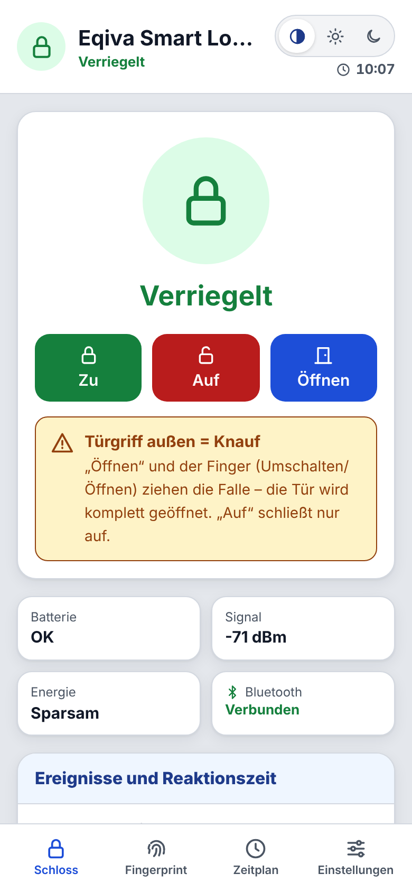
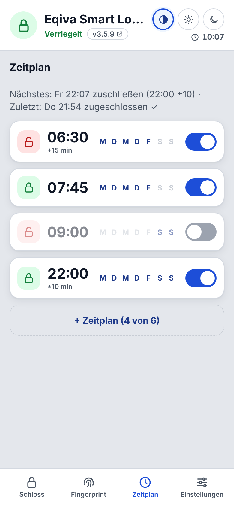
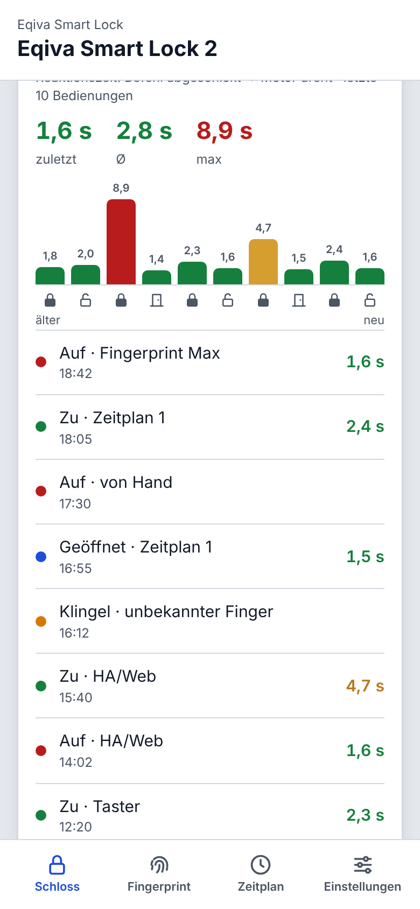
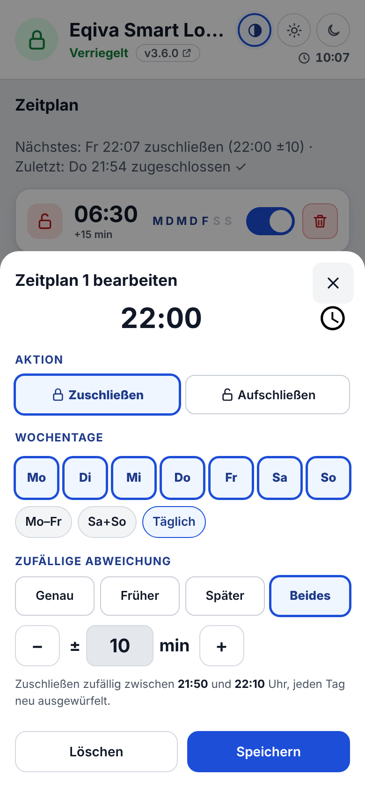
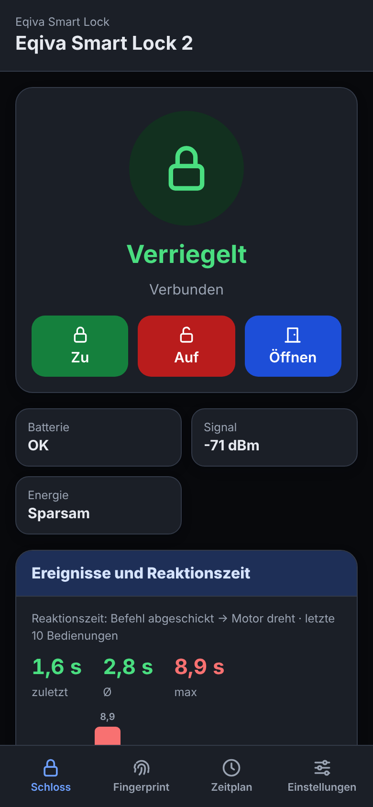
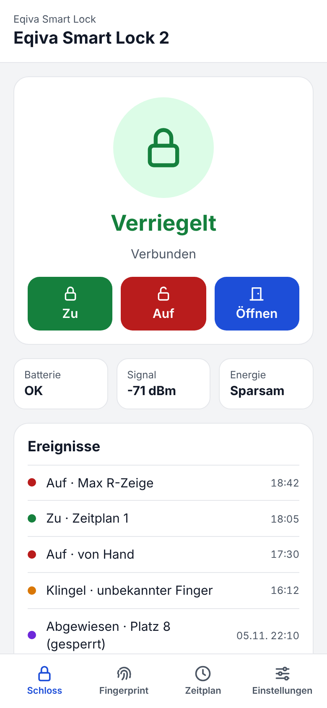
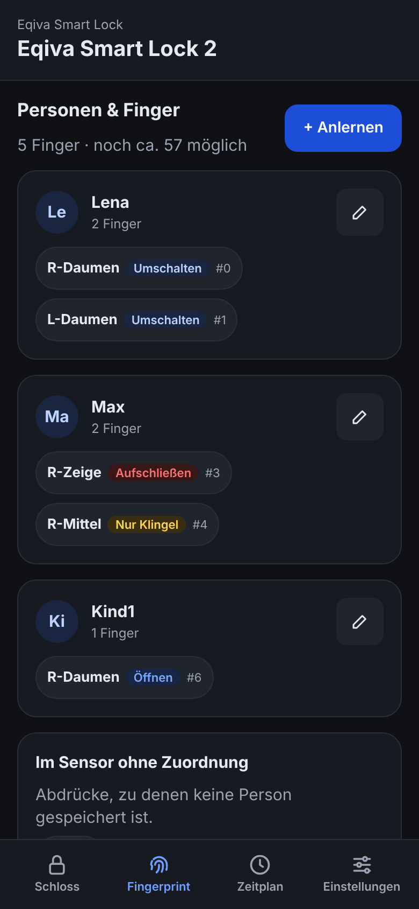
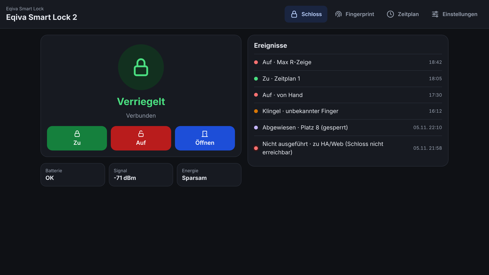

# esphome-components-eqiva (Fork mit Stabilitäts-, Sicherheits- und Komfort-Patches)

Fork von [digaus/esphome-components-eqiva](https://github.com/digaus/esphome-components-eqiva).
Protokoll und Verschlüsselung sind unverändert. Die wichtigsten Änderungen:

- **Sicherheit:** User Key beim Pairing aus dem Hardware-Zufallsgenerator (vorher per `rand()` erratbar), keine Schlüssel mehr im Log
- **Zuverlässigkeit:** Watchdog für verlorene Antworten, Befehle verfallen statt verspätet ausgeführt zu werden, Speicherfehler und Abstürze behoben
- **Energiemodi:** Schnell / Ausgewogen / Sparsam, live umschaltbar
- **Neu:** RSSI-Sensor der Verbindung, `on_paired`-Auslöser, klare Meldungen bei fehlendem Pairing oder Pairing-Modus
- **Beispiel-Konfiguration** in [`examples/`](examples/): Web-App (hell/dunkel), Pairing-Info, Energiemodi, Testmodus ohne Schloss und optionale Pakete für R503-Fingerprint, Status-LED, Statistik und Zeitplan

Alle Details: [FORK-CHANGES.md](FORK-CHANGES.md)
Versionen und Änderungen: [CHANGELOG.md](CHANGELOG.md)

## Web-App

Die Bedienung läuft über eine eigene Web-App direkt auf dem ESP – am Handy und am PC, hell oder dunkel,
auch ohne Home Assistant und ohne Internet. Die ESPHome-Tabelle bleibt als „Expertenansicht“ erreichbar.

| Schloss (hell) | Zeitplan | Reaktionszeit |
|---|---|---|
|  |  |  |

| Zeitplan bearbeiten | Schloss (dunkel) |
|---|---|
|  |  |

Die Bilder zeigen Testdaten aus dem Testmodus, keine echten Bedienungen.

| Handy (hell) | Handy (dunkel) |
|---|---|
|  |  |



## Installation

1. Die Dateien aus [`examples/`](examples/) in den ESPHome-Ordner kopieren (meist `/config/esphome/`).
2. [`secrets.example.yaml`](examples/secrets.example.yaml) als `secrets.yaml` übernehmen und ausfüllen.
3. In `eqiva-smart-lock-1.yaml` oben unter `substitutions` die Pins und die gewünschten Pakete einstellen
   (`use_fingerprint`, `use_status_led`, `use_stats`, `use_schedule`, `use_simulation`).
4. Die Komponente wird direkt aus diesem Repository geladen, fest auf die Version der Beispiel-YAMLs:

   ```yaml
   external_components:
     - source: github://2nice4u/esphome-components-eqiva@v3.5.0
   ```

   YAMLs und Komponente gehören zusammen. Für ein Update die Dateien des neuen
   [Releases](https://github.com/2nice4u/esphome-components-eqiva/releases) holen und die Nummer hinter `@` anpassen.

5. Flashen, `http://<IP des ESP>/` öffnen und der [Anleitung](docs/ANLEITUNG.md) folgen (MAC-Adresse und
   Schlüssel werden in der Expertenansicht eingetragen, nicht in der YAML).

## Anleitung & Hilfe

Die vollständige Anleitung (Werksreset, Pairing, Bedienung, Energiemodi, Fingerprint, Zeitplan, Testmodus,
Sicherheit und Fehlersuche): **[docs/ANLEITUNG.md](docs/ANLEITUNG.md)**.
Die Web-App verlinkt sie unter Einstellungen → „Anleitung“.


## Einsatzbereich und Grenzen

Gedacht für **private Haushalte und kleine Gruppen**, nicht als Zutrittskontrolle für Firmen.

| Was | Grenze |
|---|---|
| Personen (Fingerprint) | 16, Name max. 15 Zeichen |
| Finger mit Zuordnung (Person/Hand/Finger/Aktion) | ca. 55 (begrenzt durch die Sicherung im Notizspeicher des R503, 512 Byte; abhängig von der Namenslänge) – darüber wird das Anlernen abgelehnt |
| Abdrücke im R503 | 200 (Plätze 0–199) |
| Übersicht „Angelernte Finger“ | ca. 10–13 Finger, danach „+N weitere“ (Home Assistant: max. 255 Zeichen); vollständige Liste im Log |
| Zeitpläne | 2 |
| Schloss pro ESP | 1 (für jedes Schloss ein eigener ESP) |

Außerdem fehlen für einen Firmeneinsatz: Protokoll, wer wann geöffnet hat (nur „Letzte Aktion“),
Benutzerverwaltung mit Rollen, Ablaufdatum für Zugänge und eine Notfall-Freigabe über eine zentrale Stelle.
Der Fingerprint-Sensor ist außerdem kein zertifiziertes Sicherheitsprodukt.

## Original-Dokumentation

Die Beschreibung der ursprünglichen Komponente (Konfigurationsoptionen, Beispiel ohne die Pakete dieses Forks)
steht in der README des Originals:
[github.com/digaus/esphome-components-eqiva](https://github.com/digaus/esphome-components-eqiva#readme)

## Lizenz

Wie das Original unter der ESPHome-Lizenz (MIT und GPL), siehe [LICENSE](LICENSE).
