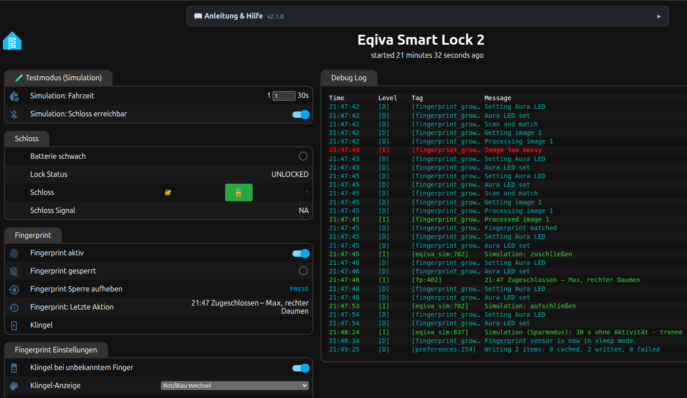

# esphome-components-eqiva (Fork mit Stabilitäts-, Sicherheits- und Komfort-Patches)

Fork von [digaus/esphome-components-eqiva](https://github.com/digaus/esphome-components-eqiva).
Protokoll und Verschlüsselung sind unverändert. Die wichtigsten Änderungen:

- **Sicherheit:** User Key beim Pairing aus dem Hardware-Zufallsgenerator (vorher per `rand()` erratbar), keine Schlüssel mehr im Log
- **Zuverlässigkeit:** Watchdog für verlorene Antworten, Befehle verfallen statt verspätet ausgeführt zu werden, Speicherfehler und Abstürze behoben
- **Energiemodi:** Schnell / Ausgewogen / Sparsam, live umschaltbar
- **Neu:** RSSI-Sensor der Verbindung, `on_paired`-Auslöser, klare Meldungen bei fehlendem Pairing oder Pairing-Modus
- **Beispiel-Konfiguration** in [`examples/`](examples/): Web-GUI mit Anleitung, Pairing-Info, Energiemodi, Testmodus ohne Schloss und optionale Pakete für R503-Fingerprint, Status-LED, Statistik und Zeitplan

Alle Details: [FORK-CHANGES.md](FORK-CHANGES.md)
Versionen und Änderungen: [CHANGELOG.md](CHANGELOG.md)

## Web-GUI

Alle Einstellungen und die Anleitung sind direkt in der Web-GUI des ESP erreichbar – auch ohne Home Assistant.



## Installation

1. Die Dateien aus [`examples/`](examples/) in den ESPHome-Ordner kopieren (meist `/config/esphome/`).
2. [`secrets.example.yaml`](examples/secrets.example.yaml) als `secrets.yaml` übernehmen und ausfüllen.
3. In `eqiva-smart-lock-1.yaml` oben unter `substitutions` die Pins und die gewünschten Pakete einstellen
   (`use_fingerprint`, `use_status_led`, `use_stats`, `use_schedule`, `use_simulation`).
4. Die Komponente wird direkt aus diesem Repository geladen:

   ```yaml
   external_components:
     - source: github://2nice4u/esphome-components-eqiva@main
       refresh: 1d
   ```

5. Flashen, die Web-GUI des ESP öffnen und der Anleitung unten folgen (MAC-Adresse und Schlüssel werden
   nur in der Web-GUI eingetragen, nicht in der YAML).

## Anleitung & Hilfe

Derselbe Text steht aufklappbar oben in der Web-GUI („📖 Anleitung & Hilfe“).

### 1. Werksreset (optional)

> Nötig, wenn das Schloss neu eingerichtet werden soll. Alle Benutzer und Einstellungen gehen verloren.

1. Batteriedeckel abziehen und **eine** Batterie herausnehmen.
2. Taste **Verriegeln** gedrückt halten und dabei die Batterie wieder einsetzen.
   Halten, bis die LED **schnell orange blinkt** (ca. 4 s), dann loslassen.
3. **Verriegeln** erneut ca. 4 s halten, bis die LED **grün** leuchtet.
4. Das Schloss fährt einmal auf „offen“ und startet neu.

### 2. Pairing (Schloss mit dem ESP koppeln)

1. QR-Code der **Keycard** mit einer beliebigen QR-App scannen.
2. Den **kompletten Text** (beginnt mit `M001A…`) unten bei
   **BLE Pair Card Key** einfügen und mit Enter bestätigen.
   Die MAC-Adresse wird daraus automatisch übernommen.
3. Am Schloss die Taste **Öffnen** ca. 5 s halten, bis die LED **schnell orange blinkt**.
4. Sofort **BLE Pair \_Start\_** drücken.
5. Fertig, wenn der **Einrichtungsstatus** ✅ zeigt und **Lock Status** einen Zustand anzeigt.

### 3. Nach einem Werksreset: Schloss einstellen

Unter **Schloss Einstellungen** Schließrichtung, Schlüsselposition und Umdrehungen wählen,
dann **Lock Settings \_Apply\_** drücken.

### 4. Bedienung: Zuschließen, Aufschließen, Öffnen

| Button | Was passiert |
| --- | --- |
| **Zuschließen** | Riegel wird zugeschlossen |
| **Aufschließen** | Riegel wird aufgeschlossen, die Tür bleibt zu (Klinke drücken zum Öffnen) |
| **Öffnen** | aufschließen und **Tür komplett öffnen** (Schloss zieht die Falle kurz zurück) – Tür lässt sich auch mit Knauf aufziehen |

Was „Öffnen“ macht, hängt von der Auswahl **„Türgriff außen“** (Schloss Einstellungen) ab:

| Türgriff außen | „Öffnen“ bewirkt |
| --- | --- |
| **Knauf** (Standard) | Tür wird **komplett geöffnet** und lässt sich von außen aufziehen |
| **Türklinke** | wie „Aufschließen“ – die Klinke drückt man selbst. Ist das Schloss schon auf, passiert nichts. |

> Gilt für alle Wege: Web-GUI, Home Assistant (`lock.open`) und Fingerprint
> mit Aktion „Öffnen“. Beim kompletten Öffnen meldet „Lock Status“ kurz **OPENED**, beim reinen Aufschließen nicht.

### 5. Eqiva-App zusätzlich nutzen

Das Schloss erlaubt nur **eine** Bluetooth-Verbindung gleichzeitig.
Vor der App **BLE Settings \_Disconnect\_** drücken, danach **BLE Settings \_Save\_**.

### 6. Energiemodus (Batterie im Schloss)

- **Schnell**: Dauerverbindung, Tür öffnet am schnellsten, höchster Batterieverbrauch.
- **Ausgewogen**: Dauerverbindung mit längerem Verbindungsabstand (Standard 100 ms).
  Spart Batterie, Befehle brauchen etwas länger.
- **Sparsam**: Verbindet nur bei Bedarf und trennt nach Leerlauf (Standard 30 s).
  Der erste Befehl dauert ca. 3–5 s. Der Status wird periodisch abgefragt (Standard alle 30 min).
  Wird das Schloss von Hand bedient, sieht Home Assistant das erst bei der nächsten Abfrage.

> Umschalten wirkt sofort, ohne neu zu flashen.

### 7. Bluetooth-Empfang („Schloss Signal“)

| Wert | Bewertung | Erwartung |
| --- | --- | --- |
| -70 dBm und besser | 🟢 gut | zuverlässig, schnelle Verbindung |
| -70 bis -85 dBm | 🟡 mittel | funktioniert, gelegentlich längere Verbindungszeiten |
| schlechter als -85 dBm | 🔴 schlecht | Fehlversuche und lange Wartezeiten wahrscheinlich |

> Je näher an 0, desto besser (-60 ist besser als -80). Der Wert wird während einer
> Verbindung alle 15 s gemessen; im Sparmodus bleibt nach dem Trennen der letzte Wert stehen.

### 8. Fingerprint (nur mit R503)

**Anlernen** (Gruppe „Fingerprint Anlernen“):

1. **Person** eintragen, **Hand** und **Finger** wählen.
2. **Aktion dieses Fingers** wählen (siehe Tabelle).
3. **Finger anlernen** drücken und den Finger so oft auflegen, wie „Anlern-Scans“ angibt.
   Ring **lila atmend** = Finger auflegen · **2× grün** = Bild ok, abheben und erneut auflegen ·
   **2× gelb** = schief aufgelegt, nochmal · **grün atmend** = fertig. „Letzte Aktion“ zeigt „Bild 2 von 5 ok“.

Die Übersicht **„Angelernte Finger“** zeigt alle Finger, z. B. `#0 St R-Daumen ⇄ · #1 St L-Daumen ⇄ · #8 ohne Zuordnung` (# = Speicherplatz im Sensor).
Passt nicht alles hinein, endet sie mit „+N weitere (siehe Log)“. Kurze Namen (z. B. „St“) zeigen mehr Finger.

- **Finger wird schlecht erkannt:** dieselbe Person/Hand/Finger wählen und erneut **Finger anlernen** –
  der alte Abdruck wird überschrieben.
- **Person umbenennen** (z. B. „Maximilian“ → „Max“): bei **Person** den alten, bei **Neuer Name** den
  neuen Namen eintragen, **Person umbenennen** drücken. Finger, Plätze und Aktionen bleiben, nichts neu anlernen.
  Gibt es den neuen Namen schon, fragt der ESP nach: innerhalb von 10 s erneut drücken führt beide Personen
  zusammen. Haben beide denselben Finger (z. B. beide R-Daumen), wird abgelehnt – erst einen davon löschen.
- **Aktion ändern:** Finger auswählen, neue Aktion wählen, **Aktion übernehmen**.
- **Entfernen:** Finger auswählen, **Finger löschen**. Einzelnen Platz per Nummer
  (auch ohne Zuordnung): **Speicherplatz (Nr.)** eintragen, **Speicherplatz löschen**.
  **Alle Finger löschen**: innerhalb von 10 s zweimal drücken.
- **Schon früher angelernte Finger** (Anzahl: „Fingerabdrücke gespeichert“):
  **Fingerprint aktiv** ausschalten, Finger auflegen – „Letzte Aktion“ zeigt „Platz X (ohne Zuordnung)“.
  Dann Person/Hand/Finger/Aktion wählen und **Letzten Finger zuordnen** drücken.
  Danach **Fingerprint aktiv** wieder einschalten.

| Aktion | Was passiert |
| --- | --- |
| ⇄ **Umschalten** | Schloss zu → öffnen (wie Button „Öffnen“, beachtet „Türgriff außen“); Schloss offen → zuschließen. Ohne Verbindung wird zuerst der aktuelle Status geholt. |
| 🔓 **Aufschließen** | nur aufschließen |
| 🔒 **Zuschließen** | nur zuschließen |
| 🚪 **Öffnen** | wie Button „Öffnen“ |
| 🔔 **Nur Klingel** | keine Schlossaktion, löst die Klingel aus (siehe unten) |
| ⛔ **Gesperrt** | Finger vorübergehend deaktiviert, ohne ihn zu löschen |
| **Standard** | nutzt „Standard-Aktion“ (Fingerprint Einstellungen) |

**Ring-Farben:**

| Ring | Bedeutung |
| --- | --- |
| 🔵 blau | Finger wird gelesen |
| 🟢 grün atmend | erkannt – Aktion läuft. Finger darf weg. |
| 🟢 grün, 2 s an | bestätigt: **verriegelt** |
| 🔴 rot, 2 s an | bestätigt: **aufgeschlossen / geöffnet** |
| 🔴 rot atmend | Finger nicht erkannt |
| 🔴 rot blinkend | Fehler: Schloss nicht erreicht oder Status unbekannt |
| 🟣 lila blinkend | abgewiesen (Fingerprint aus, Sperre nach Fehlversuchen, Übereinstimmung zu gering, Finger gesperrt) |
| 🟡 gelb blinkend | Finger schlecht aufgelegt – nochmal versuchen |
| 🌈 Regenbogen (Standard) | Klingel – Muster wählbar unter „Klingel-Anzeige“: Regenbogen, Weiß atmen, Blau blinken, Rot/Blau, Gelb/Grün oder Aus |
| 🟣 lila atmend | Anlernen: Finger auflegen (nach 2× grün: abheben und erneut auflegen) |
| 🟢 / 🔴 / 🔵 atmend (2×) | Schloss wurde **ohne Finger** bedient (HA, Web-GUI, Zeitplan, Schlüssel): grün = zugeschlossen, rot = aufgeschlossen, blau = geöffnet. Abschaltbar: „Ring-Anzeige bei Bedienung ohne Finger“. |

**Status-LED am ESP** (WS2812): 🟢 grün = verriegelt · 🔴 rot = aufgeschlossen ·
🔵 blau = geöffnet · 🟠 orange pulsierend = Motor läuft · 🟣 lila blinkend = unbekannt.

**Klingel:** Mit **„Klingel bei unbekanntem Finger“** (Fingerprint Einstellungen) klingelt ein
nicht erkannter Finger, ebenso Finger mit der Aktion „Nur Klingel“. In Home Assistant erscheint das als
Entität **„Klingel“** (für Automationen, z. B. Push-Nachricht). Damit es nicht klingelt, wenn der
eigene Finger einmal schlecht gelesen wird, wartet der ESP die **„Klingel-Verzögerung“**
(Standard 5 s): Wird in dieser Zeit ein bekannter Finger erkannt, klingelt es nicht. Danach folgt die einstellbare **„Klingel-Pause“** (Standard 30 s).
Auch ein schlecht aufgelegter Finger (gelb) löst die Klingel nach der Verzögerung aus.

**Zuordnung sichern / umziehen:** Die Abdrücke liegen im R503, die Zuordnung (Person, Hand, Finger,
Aktion) auf dem ESP **und zusätzlich im Notizspeicher des R503** (wird nach jeder Änderung automatisch
gesichert). Kommt der Sensor an einen neuen ESP ohne Zuordnung, übernimmt dieser sie beim Start von selbst.
Von Hand: **Zuordnung aus Sensor laden**. Die vollständige Liste mit Speicherplätzen steht nach jedem
Start und jeder Änderung im Log.

„Angelernte Finger“ zeigt auch Plätze, die im Sensor belegt sind, aber keine Zuordnung haben
(*ohne Zuordnung: #3*) – zuordnen mit „Letzten Finger zuordnen“ oder löschen mit „Speicherplatz löschen“.

**Grenzen:** max. **16 Personen**, Plätze 0–199. Wie viele Finger zugeordnet werden können, bestimmt die
Sicherung im Sensor (512 Byte): ca. **55 Finger** bei kurzen Namen, mit langen etwas weniger. Passt eine neue
Zuordnung nicht mehr hinein, wird das Anlernen **abgelehnt**. Wird eine Grenze knapp (unter 10 %), steht
⚠️ in „Letzte Aktion“ und „⚠️ fast voll“ am Ende der Übersicht. Gedacht für Haushalte, nicht als
Zutrittskontrolle für Firmen.

> Den Finger nach dem Erkennen einfach abnehmen. Solange eine Aktion läuft und noch
> „Scan-Pause nach Aktion“ (Standard 3 s) danach, werden weitere Scans ignoriert – so schaltet
> „Umschalten“ nie zweimal. Was zuletzt passiert ist, steht in **„Fingerprint: Letzte Aktion“**.

### 9. Zeitplan

Zwei Zeitpläne, z. B. „täglich 22:00 zuschließen“ und „Mo–Fr 07:45 zuschließen“ (Gruppe „Zeitplan“):

1. **Uhrzeit**, **Wochentage** und **Aktion** (Zuschließen/Aufschließen) einstellen.
2. **Zeitplan … aktiv** einschalten.

| Wochentage | Bedeutung |
| --- | --- |
| `Mo-So` oder `täglich` | jeden Tag |
| `Mo-Fr` | Montag bis Freitag |
| `Sa,So` | Wochenende |
| `Mo-Do,So` | Montag bis Donnerstag und Sonntag |
| `Fr-Mo` | Freitag bis Montag (über das Wochenende) |

Die Anzeige **„Zeitplan“** zeigt den nächsten Termin und das letzte Ergebnis
(✓ bestätigt, ✗ Schloss hat nicht reagiert). Ohne Bestätigung wird bis zu 3× im Minutenabstand wiederholt.

> Die Uhrzeit kommt per SNTP aus dem Internet, ersatzweise von Home Assistant – der Zeitplan
> läuft also auch ohne HA. Ohne gültige Uhrzeit pausiert er (Meldung in „Zeitplan“).

### 10. Testmodus (ohne Schloss)

Zum Testen von Fingerprint, LEDs und Zeitplan, ohne das Schloss zu belasten:
in der YAML `use_simulation: "true"` setzen und flashen. Das Schloss wird nachgebildet,
„Einrichtungsstatus“ zeigt 🧪 TESTMODUS.

- **Simulation: Fahrzeit** – wie lange der „Motor“ läuft (MOVING).
- **Simulation: Schloss erreichbar** – aus = Schloss nicht erreichbar, Befehle verfallen
  (testet die rote Fehleranzeige).
- Energiemodus „Sparsam“ simuliert auch den Verbindungsaufbau (ca. 2 s).

> Für den Betrieb am Schloss wieder `use_simulation: "false"` setzen.
> Angelernte Finger und Einstellungen bleiben erhalten.

### Wenn es nicht klappt

- **„nicht im Pairing-Modus“** im Log: Öffnen-Taste länger halten, bis die LED orange blinkt.
- **„Card key fehlt oder ungültig“**: Nicht der komplette QR-Text eingefügt.
  Das Feld ist nach jedem Neustart leer.
- **„nicht (mehr) angelernt“**: Neu pairen (Schritt 2).
- **Einrichtungsstatus ⚠️ „User ID … eingestellt, gekoppelt wurde User …“**:
  Bei **BLE Settings User ID** die Nummer aus **Pairing-Info** eintragen und
  **BLE Settings \_Save\_** drücken.
- **Schloss Signal unter -85 dBm**: ESP näher ans Schloss, Antenne ausrichten oder bessere Antenne.

> Keycard bzw. QR-Text sicher aufbewahren (z. B. Passwortmanager).
> Ohne ihn ist nach einem Reset kein Pairing möglich.

## Einsatzbereich und Grenzen

Gedacht für **private Haushalte und kleine Gruppen**, nicht als Zutrittskontrolle für Firmen.

| Was | Grenze |
|---|---|
| Personen (Fingerprint) | 16, Name max. 15 Zeichen |
| Finger mit Zuordnung (Person/Hand/Finger/Aktion) | ca. 55 (begrenzt durch die Sicherung im Notizspeicher des R503, 512 Byte; abhängig von der Namenslänge) – darüber wird das Anlernen abgelehnt |
| Abdrücke im R503 | 200 (Plätze 0–199) |
| Übersicht „Angelernte Finger“ | ca. 10–13 Finger, danach „+N weitere“ (Home Assistant: max. 255 Zeichen); vollständige Liste im Log |
| Zeitpläne | 2 |
| Schloss pro ESP | 1 (für jedes Schloss ein eigener ESP) |

Außerdem fehlen für einen Firmeneinsatz: Protokoll, wer wann geöffnet hat (nur „Letzte Aktion“),
Benutzerverwaltung mit Rollen, Ablaufdatum für Zugänge und eine Notfall-Freigabe über eine zentrale Stelle.
Der Fingerprint-Sensor ist außerdem kein zertifiziertes Sicherheitsprodukt.

## Original-Dokumentation

Die Beschreibung der ursprünglichen Komponente (Konfigurationsoptionen, Beispiel ohne die Pakete dieses Forks)
steht in der README des Originals:
[github.com/digaus/esphome-components-eqiva](https://github.com/digaus/esphome-components-eqiva#readme)

## Lizenz

Wie das Original unter der ESPHome-Lizenz (MIT und GPL), siehe [LICENSE](LICENSE).
