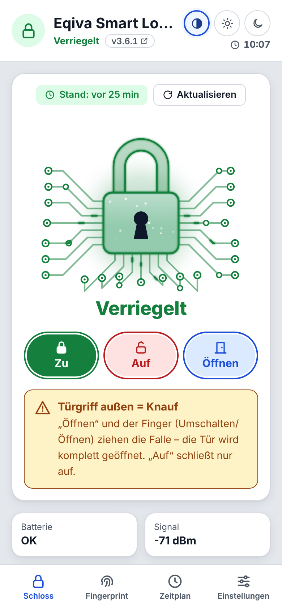
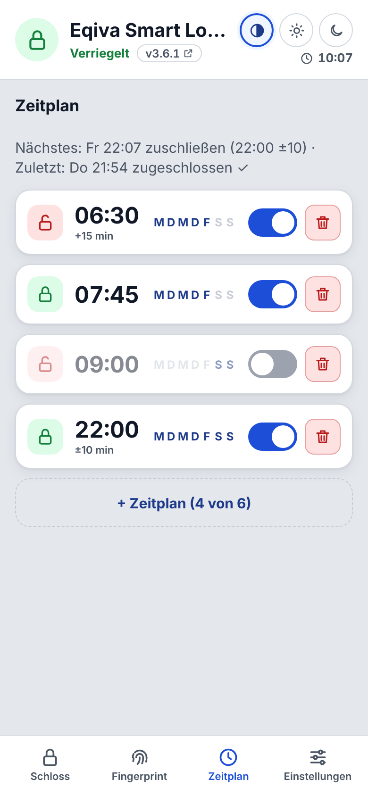
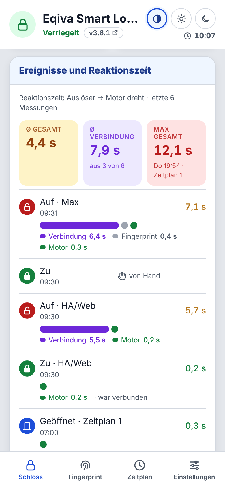
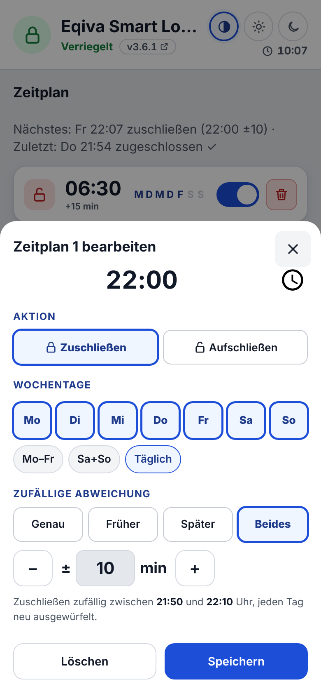
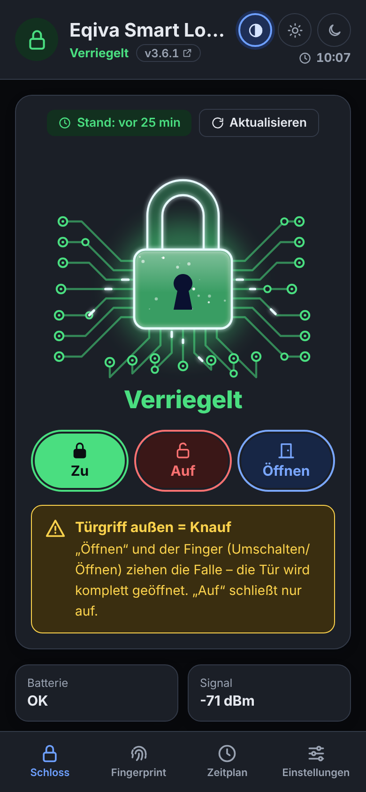
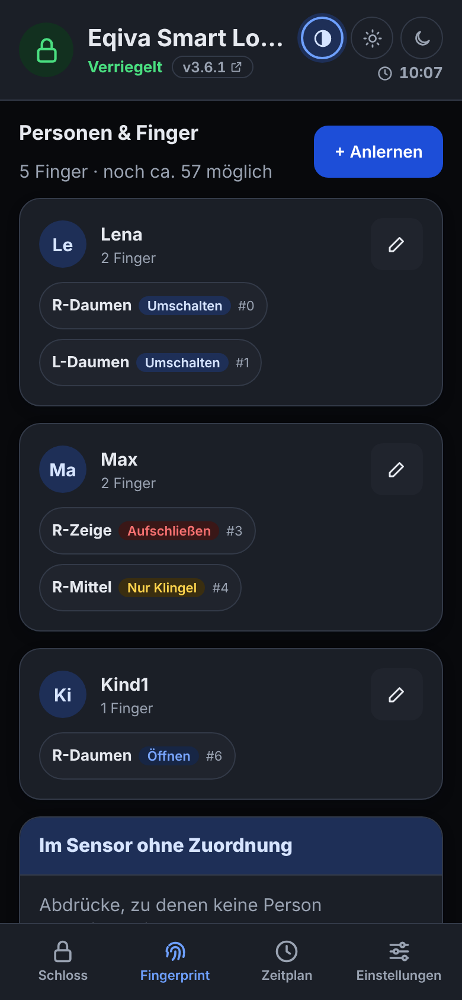
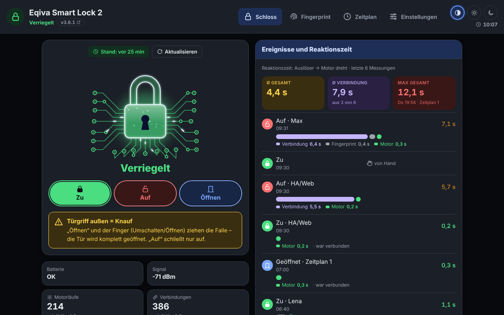

# esphome-components-eqiva (fork with stability, security and convenience patches)

🇬🇧 English · [🇩🇪 Deutsch](README.de.md)

ESPHome component for the **eQ-3 / Eqiva Bluetooth Smart Lock (Key-BLE)**, a fork of
[digaus/esphome-components-eqiva](https://github.com/digaus/esphome-components-eqiva).
The lock protocol and encryption are unchanged. Main changes:

- **Security:** user key generated by the hardware random number generator during pairing (the original used a guessable `rand()`); keys never appear in the log, in Home Assistant or in the web API; length checks on every response from the lock
- **Reliability:** watchdog for lost responses; commands expire instead of being executed late; memory bugs and crashes fixed; duplicate commands are ignored
- **Power modes:** Fast / Balanced / Eco (connect on demand), switchable at runtime
- **Web app served by the ESP:** control, pairing via the QR text of the key card, lock drive settings, unpairing (swap the lock), settings backup as a file (without keys)
- **Event log:** who locked or unlocked and when, manual operation, doorbell, tamper alerts (last 10 events, kept across restarts)
- **Reaction time:** time from trigger to motor start, split into connection, fingerprint and motor, with average, maximum and traffic-light colours
- **Safe pairing:** a failed or cancelled pairing keeps the previous pairing; "lock unreachable" detection
- **Counters:** motor runs and connections since the last battery change, with a history of the last 3 battery sets
- **Additions to the component:** RSSI sensor, `on_paired` trigger, clear messages when pairing is missing or the lock is not in pairing mode
- **Example configuration** in [`examples/`](examples/): power modes, simulation mode without a lock, and optional packages for an R503 fingerprint sensor, a WS2812 status LED and up to 6 schedules (optionally randomised, offline via SNTP)

**Last used in production with ESPHome 2026.10.2** (listed for every version in the [CHANGELOG](CHANGELOG.md); the running version is shown in the web app under Diagnostics).

> **Language:** the web app, entity names, messages and the user guide are currently **German only**.
> An English version (switchable with `language: "en"` in the main YAML) is planned for the next release.

All details: [FORK-CHANGES.md](FORK-CHANGES.md) (German) ·
Versions and changes: [CHANGELOG.md](CHANGELOG.md) (German)

## Web app

The lock is operated through a web app that runs directly on the ESP, on phone and PC, in light or dark mode,
without Home Assistant and without internet. The standard ESPHome table remains available as the "expert view".

| Lock (light) | Schedules | Events and reaction time |
|---|---|---|
|  |  |  |

| Edit schedule | Lock (dark) | Fingerprint (dark) |
|---|---|---|
|  |  |  |



The screenshots show test data, no real people or events.

## Installation

1. Copy the files from [`examples/`](examples/) into your ESPHome folder (usually `/config/esphome/`).
2. Copy [`secrets.example.yaml`](examples/secrets.example.yaml) to `secrets.yaml` and fill it in.
3. In `eqiva-smart-lock-1.yaml`, set the pins and the packages you want under `substitutions`
   (`use_fingerprint`, `use_status_led`, `use_schedule`, `use_simulation`).
4. The component is loaded straight from this repository, pinned to the version of the example YAMLs:

   ```yaml
   external_components:
     - source: github://2nice4u/esphome-components-eqiva@v3.6.3
   ```

   The YAMLs and the component belong together. To update, download the files of the new
   [release](https://github.com/2nice4u/esphome-components-eqiva/releases) and change the number after `@`.

5. Flash the ESP, open `http://<ESP IP address>/` and follow the [user guide](docs/ANLEITUNG.md) (German).
   The MAC address and keys are entered in the web app, not in the YAML.

## Guide and help

The full user guide covers factory reset, pairing, operation, events, power modes, reaction time, fingerprint,
schedules, simulation mode, security and troubleshooting: **[docs/ANLEITUNG.md](docs/ANLEITUNG.md)** (German; English planned).
The web app links to it under Settings → "Anleitung".

## Intended use and limits

Built for **private households and small groups**, not as access control for companies.

| What | Limit |
|---|---|
| People (fingerprint) | 16, name up to 15 characters |
| Fingers with assignment (person/hand/finger/action) | about 55 (limited by the backup in the R503 notepad, 512 bytes, depending on name length); enrolling more is refused |
| Fingerprints stored in the R503 | 200 (slots 0–199) |
| "Enrolled fingers" overview | about 10–13 fingers, then "+N more" (Home Assistant: max. 255 characters); full list in the log |
| Schedules | 6 |
| Event log | last 10 events (kept across restarts; Home Assistant keeps the history) |
| Locks per ESP | 1 (one ESP per lock) |

For company use, it also lacks a permanent log on the ESP (only the last 10 events), user management with roles,
expiry dates for access and a central emergency release. The fingerprint sensor is not a certified security product.

## Original documentation

The description of the original component (configuration options, example without this fork's packages)
is in the original README:
[github.com/digaus/esphome-components-eqiva](https://github.com/digaus/esphome-components-eqiva#readme)

## License

Like the original, under the ESPHome license (MIT and GPL), see [LICENSE](LICENSE).
